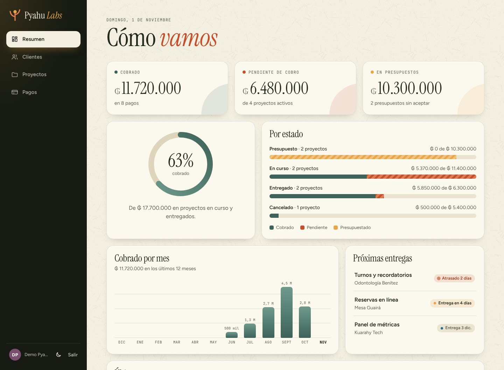
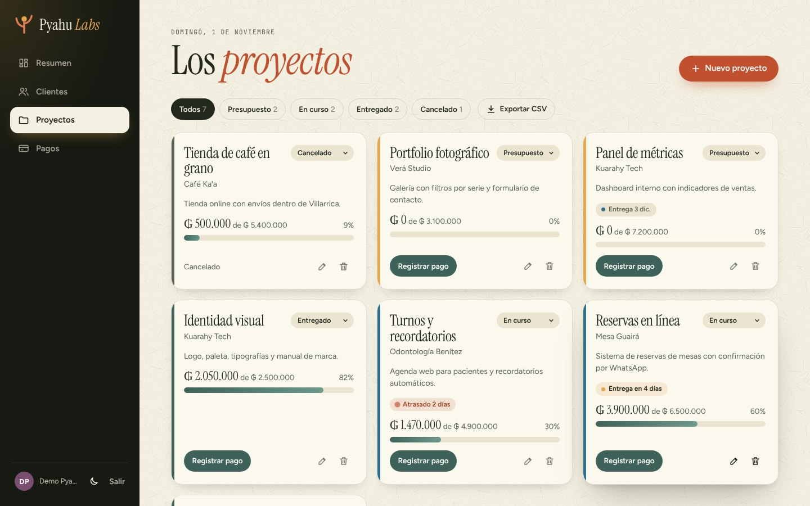
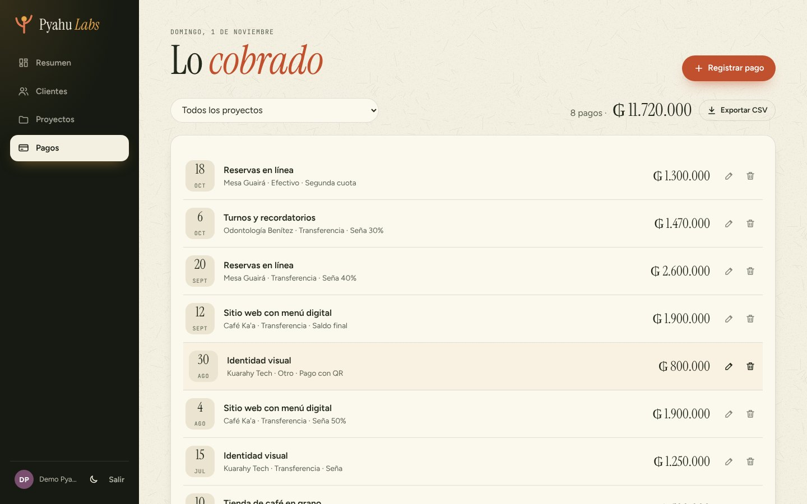
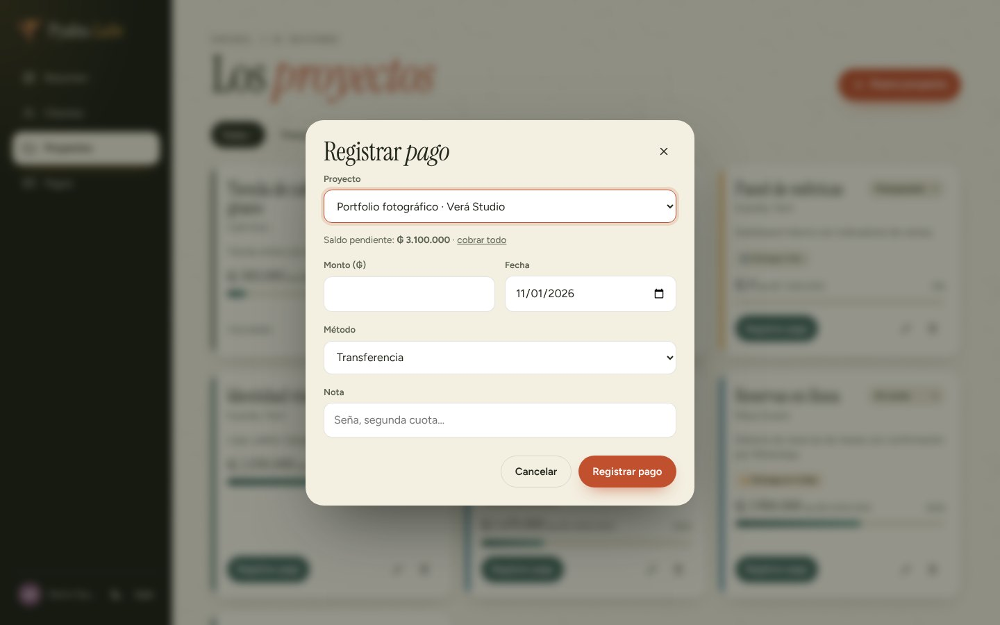
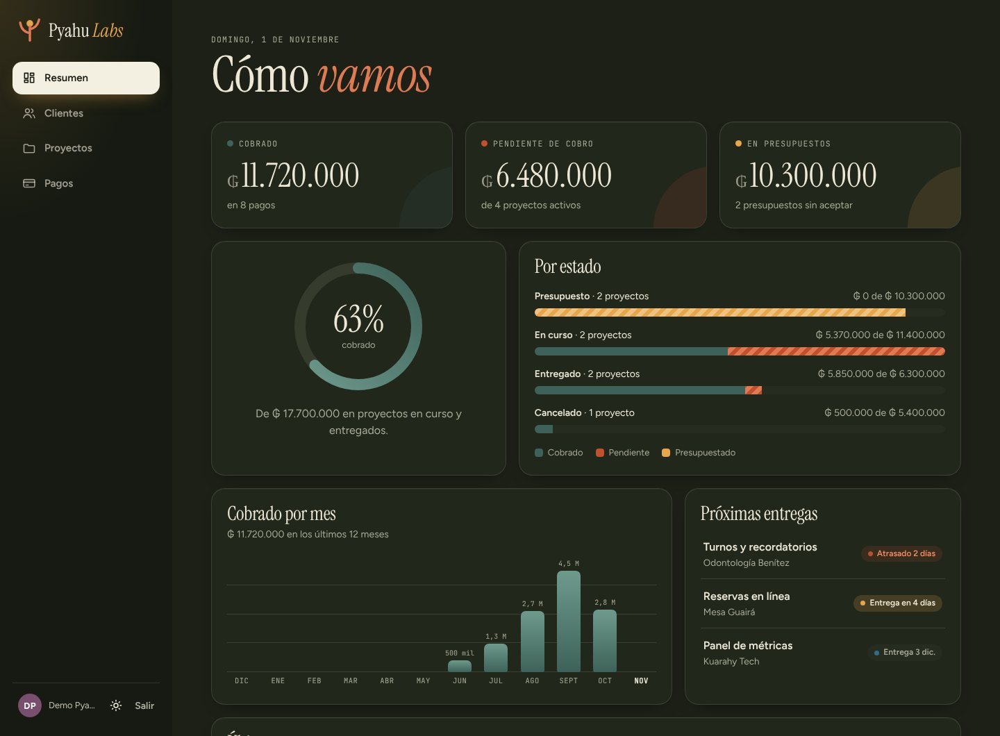
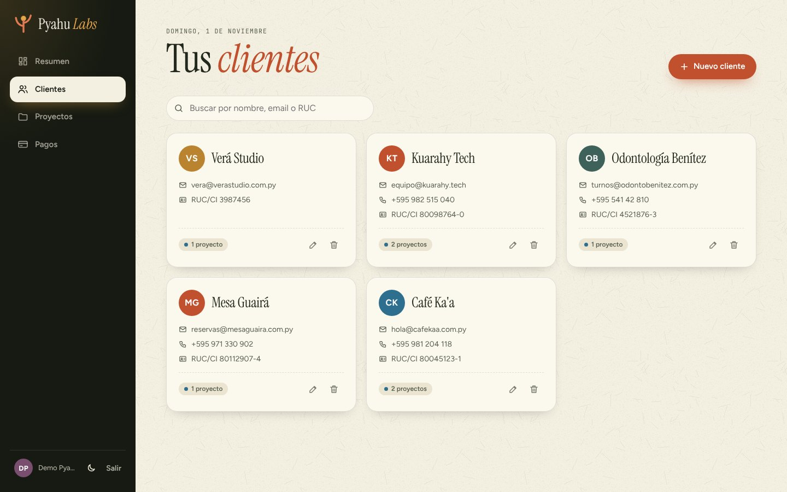
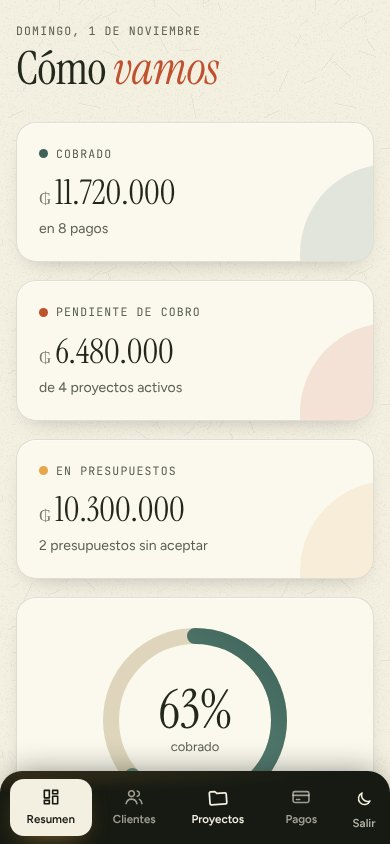
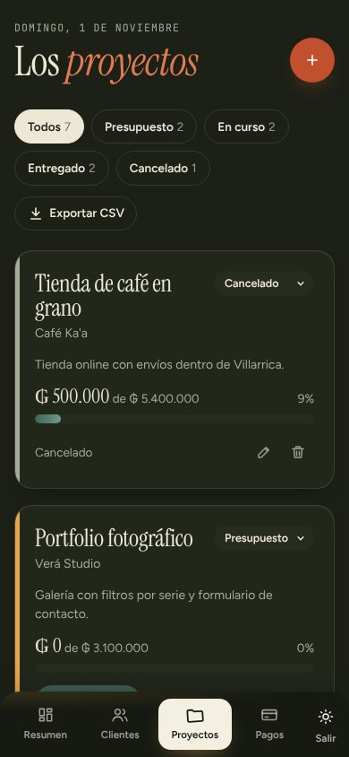

# API Pyahu Labs

API REST para gestionar los clientes, proyectos y pagos de Pyahu Labs, con un panel web para usarla desde el navegador. Hecha con Node.js, Express y MySQL, con autenticación JWT.



## Qué hace

- **Usuarios:** registro e inicio de sesión. Las contraseñas se guardan con bcrypt y el login devuelve un token JWT que dura 8 horas. El registro está **cerrado**: solo se puede crear el primer usuario (ver [Registro cerrado](#registro-cerrado)).
- **Clientes:** CRUD completo, con RUC/CI y datos de contacto.
- **Proyectos:** estado (presupuesto, en curso, entregado, cancelado), fecha de entrega opcional, edición completa y saldo pendiente calculado.
- **Pagos:** registrar, editar y borrar, con transacción y bloqueo de fila, para no cobrar nunca más que el saldo del proyecto.
- **Resumen:** total cobrado, total pendiente, lo que queda en presupuestos y lo cobrado mes por mes.
- **Seguridad:** límite de intentos de login (429 después de 8 fallidos en 15 minutos) y headers de seguridad con helmet.
- **Validación:** cada campo se revisa antes de llegar a la base (tipos, formatos, largos y fechas reales).
- **Panel web:** HTML, CSS y JavaScript sin librerías, con la identidad visual de Pyahu Labs y animaciones. Incluye un gráfico de cobros por mes, las próximas entregas, exportar a CSV (se abre en Excel), modo oscuro y se puede instalar como app en el celu.
- **Tests:** 16 tests automáticos con `npm test`, sobre una base aparte.

## Tecnologías

| Pieza | Para qué |
|---|---|
| [Express 5](https://expressjs.com/) | servidor HTTP y rutas |
| [mysql2](https://github.com/sidorares/node-mysql2) | conexión a MySQL con consultas parametrizadas |
| [jsonwebtoken](https://github.com/auth0/node-jsonwebtoken) | crear y verificar tokens JWT |
| [bcryptjs](https://github.com/dcodeIO/bcrypt.js) | encriptar contraseñas |
| [dotenv](https://github.com/motdotla/dotenv) | leer la configuración del archivo `.env` |
| [cors](https://github.com/expressjs/cors) | permitir pedidos desde otros dominios |
| [helmet](https://helmetjs.github.io/) | headers de seguridad (CSP, HSTS…) |

## Estructura

```
pyahu-api/
├── schema.sql              # crea la base y las 4 tablas
├── migraciones/            # cambios a la base después de schema.sql (npm run migrar)
├── .env.example            # plantilla de configuración
├── render.yaml             # configuración para publicarla en Render
├── docs/
│   ├── PUBLICAR.md         # guía para publicarla gratis en internet
│   └── capturas/
├── public/                 # panel web (lo sirve Express en /)
│   ├── index.html
│   ├── estilos.css
│   ├── app.js
│   ├── tema.js             # aplica el modo oscuro antes de pintar
│   ├── sw.js               # service worker: instalar como app
│   └── manifest.webmanifest
├── scripts/
│   ├── migrar.js           # npm run migrar
│   ├── datos-demo.js       # npm run demo: usuario y datos de ejemplo
│   └── probar-api.ps1      # prueba todos los endpoints desde PowerShell
├── test/                   # npm test
└── src/
    ├── server.js           # arranca el servidor
    ├── app.js              # middlewares, rutas y manejo de errores
    ├── db.js               # pool de conexiones a MySQL
    ├── middleware/
    │   ├── auth.js         # exige un token válido
    │   ├── limiteIntentos.js  # frena a quien prueba contraseñas
    │   └── validar.js      # reglas de validación por campo
    └── routes/
        ├── auth.js         # /auth/config, /auth/registro, /auth/login
        ├── clientes.js
        ├── proyectos.js
        ├── pagos.js
        └── resumen.js
```

## Cómo correrla (Windows)

Hace falta [Node.js](https://nodejs.org/) 20 o más nuevo y MySQL 8.

```powershell
# 1. Dependencias
npm install

# 2. Base de datos. En PowerShell no existe "<", por eso se usa "source":
mysql -u root -p -e "source schema.sql"

# 3. Configuración: copiar la plantilla y completar usuario y contraseña de MySQL
Copy-Item .env.example .env
notepad .env

# 4. Aplicar las migraciones (agrega lo que vino después de schema.sql)
npm run migrar

# 5. (Opcional) datos de ejemplo y usuario demo
npm run demo

# 6. Arrancar (con --watch se reinicia solo al guardar cambios)
npm run dev
```

> **¿Ya tenías la base creada de antes?** No hace falta borrarla: `npm run migrar` aplica solo los cambios que le faltan (por ejemplo, la columna `fecha_entrega`) y anota cuáles corrió en la tabla `migraciones`. Se puede correr las veces que quieras.

Abrí **http://localhost:3000** para usar el panel. Con `npm run demo` podés entrar con `demo@pyahulabs.com` / `pyahu-demo-2026` (es una cuenta solo para pruebas locales).

Para generar un `JWT_SECRET` largo y aleatorio:

```powershell
node -e "console.log(require('crypto').randomBytes(48).toString('hex'))"
```

### Registro cerrado

Para que nadie de afuera pueda crearse una cuenta en tu panel, **solo se puede registrar el primer usuario** (cuando la base no tiene ninguno). Después, la pestaña "Crear cuenta" desaparece y `POST /auth/registro` responde 403.

Si querés dejar que cualquiera se registre (por ejemplo, para probar), poné `REGISTRO_ABIERTO=true` en el `.env` y reiniciá el servidor.

### Verlo desde el celu

Con el servidor andando en la PC y el celu conectado **a la misma Wi-Fi**:

1. En la PC, buscá tu IP local con `ipconfig` (la línea "Dirección IPv4", algo como `192.168.0.15`).
2. En el navegador del celu, abrí `http://192.168.0.15:3000` (con tu IP).
3. Si no carga, Windows está bloqueando el puerto: la primera vez que corrés `npm run dev` suele preguntar si permitir Node.js en redes privadas; decí que sí.

El panel se usa igual que en la PC. Lo que **no** vas a poder hacer así es instalarlo como app: los navegadores solo dejan instalar páginas servidas por **https** (o desde `localhost`). Cuando la publiques en internet ([docs/PUBLICAR.md](docs/PUBLICAR.md)) vas a tener https y ahí sí aparece "Instalar app" (Android) o "Agregar a inicio" (iPhone, desde Compartir).

## Tests

```powershell
npm test
```

Corre 16 tests (validaciones, login, registro cerrado, clientes, proyectos, pagos y resumen) contra una base **aparte**, `pyahu_test`, que se borra y se vuelve a crear en cada corrida. Tus datos de la base `pyahu` no se tocan. Usa el mismo usuario de MySQL del `.env`.

## Endpoints

Todas las rutas, salvo `/auth` y `/estado`, requieren el header `Authorization: Bearer <token>`.

| Método | Ruta | Descripción |
|---|---|---|
| GET | `/estado` | Chequeo de que la API responde |
| GET | `/auth/config` | `{ registro_abierto }`: si se puede crear una cuenta |
| POST | `/auth/registro` | Crear usuario (`nombre`, `email`, `password` de 8 a 72 caracteres). 403 si el registro está cerrado |
| POST | `/auth/login` | Devuelve `{ token }`. 429 después de 8 intentos fallidos |
| GET | `/clientes` | Listar clientes |
| POST | `/clientes` | Crear (`nombre`; opcionales `email`, `telefono`, `ruc_ci`) |
| GET, PUT, DELETE | `/clientes/:id` | Ver, editar o borrar. Borrar un cliente borra sus proyectos y pagos |
| GET | `/proyectos` | Listar, con `cliente`, `pagado` y `saldo` |
| POST | `/proyectos` | Crear (`cliente_id`, `nombre`; opcionales `descripcion`, `estado`, `monto_total`, `fecha_entrega`) |
| PUT | `/proyectos/:id` | Editar todo el proyecto (`estado` y `monto_total` obligatorios). El monto total no puede quedar por debajo de lo ya cobrado |
| PATCH | `/proyectos/:id/estado` | Cambiar solo el estado |
| DELETE | `/proyectos/:id` | Borrar el proyecto y sus pagos |
| GET | `/pagos` | Listar (filtro opcional `?proyecto_id=`) |
| POST | `/pagos` | Registrar (`proyecto_id`, `monto`, `fecha` AAAA-MM-DD; opcionales `metodo`, `nota`) |
| PUT | `/pagos/:id` | Editar (`monto`, `fecha`, `metodo`; opcional `nota`). El proyecto no cambia y el total cobrado no puede pasar el monto del proyecto |
| DELETE | `/pagos/:id` | Borrar un pago: el saldo del proyecto vuelve a subir |
| GET | `/resumen` | Totales cobrado, pendiente y presupuestado, y detalle por estado |
| GET | `/resumen/mensual` | Cobrado por mes (`?meses=` de 1 a 36, 12 por defecto). Los meses sin pagos vienen con 0 |

### Respuestas de error

| Código | Cuándo |
|---|---|
| 400 | Datos inválidos: `{ "error": "Datos inválidos", "detalles": ["monto debe ser un número entero (sin comillas)"] }` |
| 400 | El pago supera el saldo del proyecto, o el monto total quedaría por debajo de lo ya cobrado |
| 401 | Falta el token, está vencido o las credenciales son incorrectas |
| 403 | El registro está cerrado |
| 404 | El recurso o la ruta no existen |
| 409 | El email ya está registrado |
| 429 | Demasiados intentos de login fallidos: esperá 15 minutos |
| 500 | Error inesperado del servidor (se registra en la consola) |

## Probar la API

Con el servidor andando, este script recorre todos los endpoints, incluidos los casos de error, y muestra cada respuesta:

```powershell
powershell -ExecutionPolicy Bypass -File scripts\probar-api.ps1
```

O de a uno, con `Invoke-RestMethod`:

```powershell
$api = 'http://localhost:3000'
$json = 'application/json; charset=utf-8'   # el charset hace que las tildes viajen bien

$login = @{ email = 'demo@pyahulabs.com'; password = 'pyahu-demo-2026' } | ConvertTo-Json
$token = (Invoke-RestMethod -Method Post -Uri "$api/auth/login" -ContentType $json -Body $login).token
$auth = @{ Authorization = "Bearer $token" }

Invoke-RestMethod -Uri "$api/resumen" -Headers $auth
```

> En PowerShell 5.1, `curl` es un alias de `Invoke-WebRequest`. Para usar el curl de verdad, escribí `curl.exe`.

## Publicarla en internet

En [docs/PUBLICAR.md](docs/PUBLICAR.md) hay una guía paso a paso para subirla gratis a **Render** (la API y el panel) con la base en **Aiven** (MySQL).

## Más capturas

| Proyectos | Pagos | Registrar un pago |
|---|---|---|
|  |  |  |

| Modo oscuro | Clientes | Acceso |
|---|---|---|
|  |  |  |

| Celular | Celular, modo oscuro |
|---|---|
|  |  |

Las capturas se sacan con [Playwright](https://playwright.dev/) manejando Chrome, con los datos de `npm run demo`.

## Licencia

MIT. Las fuentes del panel (Instrument Serif, Figtree y JetBrains Mono) tienen licencia SIL Open Font License.
